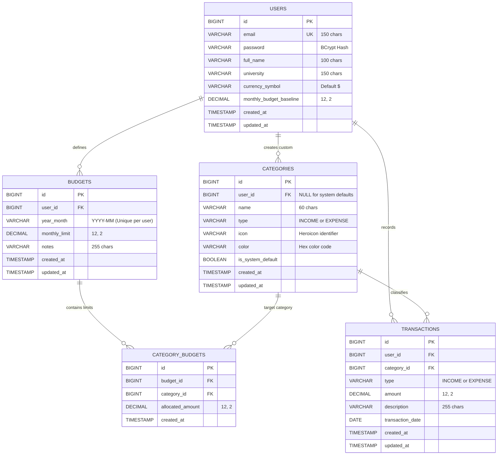

# 🎓 Student Budget Tracker

[](https://www.oracle.com/java/)
[](https://spring.io/projects/spring-boot)
[](https://spring.io/projects/spring-security)
[](https://www.mysql.com/)
[](LICENSE)
[-success.svg)](pom.xml)

A modern, full-stack personal finance web application built specifically for university and college students to master their financial habits, track limited stipends and part-time earnings, set monthly budgets, and analyze spending breakdowns with interactive visual analytics.

Designed and engineered to professional Software Engineering portfolio standards with zero placeholder code, complete server-side input validation, strict user data isolation, CSRF protection, and exact decimal arithmetic.

---

## 📑 Table of Contents

- [Project Overview & Student Motivation](#-project-overview--student-motivation)
- [Key Features](#-key-features)
- [Technology Stack](#-technology-stack)
- [System Architecture](#-system-architecture)
- [Database Schema & ER Model](#-database-schema--er-model)
- [Security Architecture](#-security-architecture)
- [Getting Started & Local Setup](#-getting-started--local-setup)
  - [Prerequisites](#prerequisites)
  - [Option A: Running with In-Memory H2 (Quick Start / Evaluation)](#option-a-running-with-in-memory-h2-quick-start--evaluation)
  - [Option B: Running with MySQL 8 (Production Grade)](#option-b-running-with-mysql-8-production-grade)
- [Environment Configuration Template](#-environment-configuration-template)
- [RESTful API Documentation](#-restful-api-documentation)
- [Automated Testing & QA Verification](#-automated-testing--qa-verification)
- [Project Directory Structure](#-project-directory-structure)
- [UI Pages & Walkthrough](#-ui-pages--walkthrough)
- [Known Limitations & Roadmap](#-known-limitations--roadmap)
- [License & Author](#-license--author)

---

## 💡 Project Overview & Student Motivation

University students often juggle irregular income sources (scholarships, student loans, campus dining plans, allowances, and part-time jobs) against strict living costs (textbooks, tuition fees, housing, groceries, and social events). Traditional commercial banking apps are frequently overcomplicated or ad-cluttered.

**Student Budget Tracker** addresses this with:
1. **Student-Centric Categories**: Pre-seeded with university-relevant defaults (Textbooks, Tuition & Fees, Transit Pass, Campus Dining, Room & Board).
2. **Zero Inaccurate Math**: Uses Java `BigDecimal` and SQL `DECIMAL(12, 2)` across the entire lifecycle to guarantee 100% financial calculation accuracy with no floating-point rounding errors.
3. **Budget Health Indicators**: Live progress indicators and warning alerts when total spending or category expenses exceed 80% and 100% of budgeted limits.
4. **Data Isolation**: Strict user-bound tenancy ensuring every transaction, budget, and category belongs exclusively to the authenticated student.

---

## 🚀 Key Features

### 1. Modern, Responsive User Interface
- **Theme Switcher**: Instant light mode and dark mode with persistent user preference in `localStorage`.
- **Mobile-First Responsive Design**: Tailored CSS Grid and Flexbox layouts optimized across mobile phones, tablets, and desktop displays.
- **Micro-Interactions**: Floating toast notification banners, animated modal dialogs, accessible forms, and active navbar indicators.

### 2. Interactive Financial Dashboard
- **Monthly Metric Cards**: Total Income, Total Expenses, Net Remaining Balance, and Overall Budget Utilization.
- **Dynamic Date Filtering**: Switch between current and past months (`YYYY-MM`) with auto-recalculated summaries.
- **Chart.js Visualizations**:
  - *Income vs Expense Doughnut*: Quick health overview of cash inflow vs outflow.
  - *Category Spending Breakdown*: Color-coded spending distribution across active categories.
  - *Historical Spending Trends*: 6-month bar chart contrasting monthly earnings with expenses.
- **Recent Transactions Feed**: Quick access to recent activity with inline edit and delete actions.

### 3. Full CRUD Transaction Management
- Record **Income** and **Expense** entries with date, monetary amount, category, and descriptive notes.
- Multi-facet search and filtering by **Type** (`ALL`, `INCOME`, `EXPENSE`), **Category**, and **Date Range** (`Start Date` to `End Date`).
- Server-side validation enforcing positive non-zero amounts, valid dates, and required categories.
- Modal-based Add/Edit flows with real-time feedback and delete confirmation prompts.

### 4. Monthly & Category Budgeting
- Set an overarching monthly limit for each calendar month.
- Allocate granular spending limits to individual expense categories (e.g., $150 for Groceries, $60 for Transit).
- Visual warning badges (`Safe`, `Warning >80%`, `Exceeded >100%`) with color-coded progress bars.
- Clear distinction between **Net Bank Balance** (Income minus Expenses) and **Remaining Budget** (Budget Limit minus Expenses).

### 5. Custom Category Management
- Includes **16 student-specific system default categories** (Groceries, Housing, Textbooks, Tuition, Transportation, Utilities, Entertainment, Scholarships, etc.).
- Students can create custom categories with custom names, transaction types, curated icon selections, and hex color tags.
- Secure cascade rules preventing deletion of categories that have existing recorded transactions.

### 6. Financial Reports & Analytics
- Comprehensive date-range financial summaries with automated **Savings Rate (%)** calculation.
- Budget vs. Actual comparison table with variance reporting.
- Grouped category breakdown tables showing exact totals and percentage share of spending.

### 7. User Profile & Account Settings
- Update display name, university affiliation, and preferred currency symbol (`$`, `€`, `£`, `¥`, `₹`, `C$`, `A$`).
- Baseline monthly budget goal stored on user profile.
- Secure BCrypt password change workflow requiring verification of the current password.

---

## 🛠 Technology Stack

| Domain | Technology | Version | Description |
| :--- | :--- | :--- | :--- |
| **Backend** | Java | 17 (LTS) | Core enterprise language |
| **Framework** | Spring Boot | 3.2.5 | Modern web application container |
| **Security** | Spring Security | 6.2.4 | Authentication, BCrypt hashing, CSRF & Session control |
| **Persistence** | Spring Data JPA / Hibernate | 6.4.4 | Object-Relational Mapping & parameterized SQL queries |
| **Database** | MySQL | 8.0+ | Production relational database engine |
| **Dev Database**| H2 Database | 2.2.224 | Embedded in-memory DB for rapid evaluation & unit tests |
| **Build Tool** | Apache Maven | 3.9.6 | Dependency management & automated build packaging |
| **Frontend** | HTML5 / CSS3 / Vanilla JS | ES6+ | Lightweight, highly responsive, zero heavy framework overhead |
| **Charting** | Chart.js | 4.4.1 | Responsive canvas-based financial charts |
| **Testing** | JUnit 5 & Mockito | 5.10.2 | Unit testing, MockMvc integration, & Spring Security tests |

---

## 🏛 System Architecture

The application adopts a clean, layered Model-View-Controller (MVC) architecture with clear separation between presentation, HTTP transport, business logic, persistence, and security:

```
┌─────────────────────────────────────────────────────────────┐
│                    Browser Client                           │
│  HTML5 + Modern CSS Design System + Vanilla JS + Chart.js   │
└──────────────────────────────┬──────────────────────────────┘
                               │  HTTPS / REST / Session Cookie
                               ▼
┌─────────────────────────────────────────────────────────────┐
│                Spring Security Filter Chain                 │
│  - CsrfFilter (CookieCsrfTokenRepository, XSRF-TOKEN)       │
│  - SecurityContextHolderFilter / Session Repository         │
│  - AuthenticationEntryPoint & AccessDeniedHandler           │
└──────────────────────────────┬──────────────────────────────┘
                               │
                               ▼
┌─────────────────────────────────────────────────────────────┐
│                     Controller Layer                        │
│  - AuthController       - TransactionController             │
│  - BudgetController     - CategoryController                │
│  - ReportController     - UserController                    │
│  - GlobalExceptionHandler (@ControllerAdvice)               │
└──────────────────────────────┬──────────────────────────────┘
                               │  DTOs (Request / Response validation)
                               ▼
┌─────────────────────────────────────────────────────────────┐
│                      Service Layer                          │
│  - AuthService          - TransactionService                │
│  - BudgetService        - CategoryService                   │
│  - ReportService        - UserService                       │
│  - SecurityUtils (Tenant Context & Ownership Checks)        │
└──────────────────────────────┬──────────────────────────────┘
                               │  JPA Entities & BigDecimal Math
                               ▼
┌─────────────────────────────────────────────────────────────┐
│                     Repository Layer                        │
│  - UserRepository       - TransactionRepository             │
│  - BudgetRepository     - CategoryRepository                │
└──────────────────────────────┬──────────────────────────────┘
                               │  JDBC / SQL Queries
                               ▼
┌─────────────────────────────────────────────────────────────┐
│                Relational Database (MySQL 8 / H2)           │
└─────────────────────────────────────────────────────────────┘
```

---

## 🗄 Database Schema & ER Model

The relational database is normalized to 3NF, utilizing foreign keys with `ON DELETE CASCADE` for user ownership, `DECIMAL(12, 2)` monetary values, and compound indexes for fast date-range filtering.

### Entity-Relationship Diagram



The schema is provisioned automatically or via [database/schema.sql](file:///c:/Users/naomi/Desktop/Tracker/database/schema.sql) and [database/seed_data.sql](file:///c:/Users/naomi/Desktop/Tracker/database/seed_data.sql).

---

## 🔒 Security Architecture

1. **Password Encryption**: Passwords hashed with BCrypt (strength 10). Plaintext passwords are never stored or logged.
2. **Session Authentication**: State is maintained via `JSESSIONID` cookies configured with `HttpOnly`, `SameSite=Strict`, and configurable session timeouts.
3. **CSRF Protection**: Spring Security's `CookieCsrfTokenRepository` generates an `XSRF-TOKEN` cookie readable by the frontend JavaScript client, which injects the `X-XSRF-TOKEN` header on every state-mutating request (`POST`, `PUT`, `DELETE`).
4. **Data Isolation (Multi-Tenancy)**:
   - All repository queries filter by `user.id = :currentUserId`.
   - Category updates and deletes verify that `category.userId == currentUserId` and prevent tampering with system defaults (`isSystemDefault == false`).
   - Transaction and budget endpoints verify ownership before updates or deletions.
5. **SQL Injection Defense**: Standardized Hibernate JPA queries and `@Query` annotations strictly use named binding parameters.
6. **XSS Protection**: Dynamic DOM content is escaped using `element.textContent` and encoded template literals rather than raw `innerHTML` injections for user text.
7. **Centralized Error Handling**: `GlobalExceptionHandler` intercepts exceptions and returns standardized `ApiResponse<T>` objects without leaking database stack traces or internal server details.

---

## 💻 Getting Started & Local Setup

### Prerequisites
- **Java Development Kit (JDK)**: Version 17 or higher
- **Maven**: Version 3.8+ (A portable Maven wrapper is included via `mvnw` and `mvnw.cmd`)
- **MySQL Server** (Optional for dev, required for production): Version 8.0+

---

### Option A: Running with In-Memory H2 (Quick Start / Evaluation)

Zero external database installation required! Ideal for instant demonstration, reviewing, and evaluating the application.

1. **Clone the repository:**
   ```bash
   git clone https://github.com/your-username/student-budget-tracker.git
   cd student-budget-tracker
   ```

2. **Run using Maven with the `dev` profile:**
   ```bash
   # Windows
   mvnw.cmd spring-boot:run -Dspring-boot.run.profiles=dev

   # Linux / macOS
   ./mvnw spring-boot:run -Dspring-boot.run.profiles=dev
   ```

3. **Or run the pre-built JAR directly:**
   ```bash
   java -Dspring.profiles.active=dev -jar target/student-budget-tracker-1.0.0.jar
   ```

4. **Access the application:**
   - Open your web browser to: `http://localhost:8080`
   - Default Seeded Student Account:
     - **Email:** `alex.student@campus.edu`
     - **Password:** `Student123!`
   - Or click **"Register an Account"** on the login page to create a fresh student profile.
   - H2 Web Console: Available at `http://localhost:8080/h2-console` (JDBC URL: `jdbc:h2:mem:student_budget_dev`, User: `sa`, Password: *blank*).

---

### Option B: Running with MySQL 8 (Production Grade)

1. **Create the MySQL Database and Seed Defaults:**
   ```bash
   # Log into MySQL CLI
   mysql -u root -p

   # Execute the schema and seed scripts
   source database/schema.sql;
   source database/seed_data.sql;
   ```

2. **Configure your Database Credentials:**
   Copy `.env.example` to `.env` or set environment variables:
   ```bash
   cp .env.example .env
   ```
   Or set environment variables in your terminal:
   ```bash
   # Windows PowerShell
   $env:DB_HOST="localhost"
   $env:DB_PORT="3306"
   $env:DB_NAME="student_budget_tracker"
   $env:DB_USERNAME="root"
   $env:DB_PASSWORD="your_mysql_password"

   # Linux / macOS
   export DB_HOST=localhost
   export DB_PORT=3306
   export DB_NAME=student_budget_tracker
   export DB_USERNAME=root
   export DB_PASSWORD=your_mysql_password
   ```

3. **Build and Launch the Application:**
   ```bash
   # Build the executable JAR
   ./mvnw clean package

   # Run with the production MySQL profile
   java -Dspring.profiles.active=mysql -jar target/student-budget-tracker-1.0.0.jar
   ```

4. **Navigate to:** `http://localhost:8080`

---

## 📄 Environment Configuration Template

The application reads externalized environment variables with sensible local defaults:

```ini
# Server Port
SERVER_PORT=8080

# Active Spring Profile (mysql | dev | test)
SPRING_PROFILES_ACTIVE=mysql

# MySQL 8 Database Configuration
DB_HOST=localhost
DB_PORT=3306
DB_NAME=student_budget_tracker
DB_USERNAME=root
DB_PASSWORD=your_secure_password

# JPA / Hibernate DDL behavior (update | validate | none)
JPA_HIBERNATE_DDL_AUTO=update

# Session Timeout (e.g., 60m, 2h)
SESSION_TIMEOUT=60m
```

---

## 📡 RESTful API Documentation

All API responses are wrapped in a standard JSON response envelope:
```json
{
  "success": true,
  "message": "Operation completed successfully.",
  "data": { ... },
  "timestamp": "2026-10-21T13:45:00Z"
}
```

### 1. Authentication Endpoints

| Method | Endpoint | Access | Description | Sample Request Body |
| :--- | :--- | :--- | :--- | :--- |
| `POST` | `/api/auth/register` | Public | Register new student account | `{"fullName":"Taylor Swift","email":"student@campus.edu","password":"Password123!","monthlyBudgetBaseline":800.00,"currencySymbol":"$"}` |
| `POST` | `/api/auth/login` | Public | Authenticate student and create session | `{"email":"student@campus.edu","password":"Password123!"}` |
| `POST` | `/api/auth/logout` | Authenticated | Invalidate session and clear cookies | *None* |
| `GET` | `/api/auth/me` | Authenticated | Fetch current authenticated student profile | *None* |

### 2. Transaction Endpoints

| Method | Endpoint | Access | Description | Sample Request Body |
| :--- | :--- | :--- | :--- | :--- |
| `GET` | `/api/transactions` | Authenticated | Query transactions with optional filters (`type`, `categoryId`, `startDate`, `endDate`, `search`, `page`, `size`) | *Query parameters* |
| `GET` | `/api/transactions/{id}`| Authenticated | Get single transaction by ID | *None* |
| `POST` | `/api/transactions` | Authenticated | Create a new income or expense transaction | `{"type":"EXPENSE","amount":65.50,"categoryId":1,"description":"Calculus Lab Manual","transactionDate":"2026-10-21"}` |
| `PUT` | `/api/transactions/{id}`| Authenticated | Update an existing transaction | `{"type":"EXPENSE","amount":72.00,"categoryId":1,"description":"Updated Manual","transactionDate":"2026-10-21"}` |
| `DELETE`| `/api/transactions/{id}`| Authenticated | Delete a transaction | *None* |

### 3. Budget Endpoints

| Method | Endpoint | Access | Description | Sample Request Body |
| :--- | :--- | :--- | :--- | :--- |
| `GET` | `/api/budgets/current` | Authenticated | Retrieve budget for specified `month` (`YYYY-MM`) with actual spending & utilization | *Query: `?month=2026-10`* |
| `GET` | `/api/budgets` | Authenticated | List all historical student budgets | *None* |
| `POST` | `/api/budgets` | Authenticated | Create or update budget with category allocations | `{"yearMonth":"2026-10","monthlyLimit":900.00,"notes":"Fall Semester","categoryAllocations":[{"categoryId":1,"allocatedAmount":250.00}]}` |
| `DELETE`| `/api/budgets/{id}` | Authenticated | Remove a monthly budget | *None* |

### 4. Category Endpoints

| Method | Endpoint | Access | Description | Sample Request Body |
| :--- | :--- | :--- | :--- | :--- |
| `GET` | `/api/categories` | Authenticated | List all system default and user custom categories | *None* |
| `GET` | `/api/categories/type/{type}` | Authenticated | Filter categories by `INCOME` or `EXPENSE` | *None* |
| `POST` | `/api/categories` | Authenticated | Create a custom category | `{"name":"Gym & Athletics","type":"EXPENSE","icon":"dumbbell","color":"#10B981"}` |
| `PUT` | `/api/categories/{id}` | Authenticated | Update custom category details | `{"name":"Campus Gym","type":"EXPENSE","icon":"dumbbell","color":"#059669"}` |
| `DELETE`| `/api/categories/{id}` | Authenticated | Delete custom category (rejects if transactions exist) | *None* |

### 5. Report & Dashboard Endpoints

| Method | Endpoint | Access | Description |
| :--- | :--- | :--- | :--- |
| `GET` | `/api/reports/dashboard` | Authenticated | Get dashboard summary metrics, recent transactions, and chart trend data for `month` |
| `GET` | `/api/reports/analytics` | Authenticated | Generate financial analytics, savings rate, and category breakdowns between `startDate` and `endDate` |

### 6. User Profile Endpoints

| Method | Endpoint | Access | Description | Sample Request Body |
| :--- | :--- | :--- | :--- | :--- |
| `GET` | `/api/user/profile` | Authenticated | Retrieve user profile settings | *None* |
| `PUT` | `/api/user/profile` | Authenticated | Update profile information | `{"fullName":"Taylor Swift","university":"MIT","currencySymbol":"$","monthlyBudgetBaseline":850.00}` |
| `PUT` | `/api/user/password` | Authenticated | Change account password | `{"currentPassword":"Password123!","newPassword":"NewSecurePassword456!"}` |

---

## 🧪 Automated Testing & QA Verification

The application features comprehensive automated test coverage implemented using JUnit 5, Mockito, Spring Boot Test, and MockMvc:

- **Service Layer Tests**: Validate business calculations (e.g., net savings rate, budget utilization percentages, negative amount rejection, category ownership checks).
- **Controller Integration Tests**: Verify Spring Security filter chains, session cookie persistence, CSRF header validation, and accurate HTTP status codes.
- **Edge Cases Tested**:
  - Month boundary transactions (first day and last day of calendar month).
  - Division by zero protection when total income is zero (safe 0.0% savings rate).
  - Rejection of negative amounts, zero amounts, and invalid date formats.
  - Multi-tenant data isolation: preventing User A from modifying User B's transactions or budgets.
  - Scale and rounding verification for monetary decimals.

### Running the Test Suite:
```bash
# Windows
mvnw.cmd test

# Linux / macOS
./mvnw test
```

### Verified Test Results:
```text
[INFO] Running com.tracker.budget.controller.AuthControllerTest
[INFO] Tests run: 3, Failures: 0, Errors: 0, Skipped: 0
[INFO] Running com.tracker.budget.controller.TransactionControllerTest
[INFO] Tests run: 3, Failures: 0, Errors: 0, Skipped: 0
[INFO] Running com.tracker.budget.service.AuthServiceTest
[INFO] Tests run: 3, Failures: 0, Errors: 0, Skipped: 0
[INFO] Running com.tracker.budget.service.BudgetServiceTest
[INFO] Tests run: 3, Failures: 0, Errors: 0, Skipped: 0
[INFO] Running com.tracker.budget.service.ReportServiceTest
[INFO] Tests run: 1, Failures: 0, Errors: 0, Skipped: 0
[INFO] Running com.tracker.budget.service.TransactionServiceTest
[INFO] Tests run: 5, Failures: 0, Errors: 0, Skipped: 0
[INFO] Running com.tracker.budget.StudentBudgetTrackerApplicationTests
[INFO] Tests run: 1, Failures: 0, Errors: 0, Skipped: 0
[INFO] ------------------------------------------------------------------------
[INFO] BUILD SUCCESS
[INFO] Tests run: 19, Failures: 0, Errors: 0, Skipped: 0
[INFO] ------------------------------------------------------------------------
```

---

## 📂 Project Directory Structure

```text
student-budget-tracker/
│
├── .env.example                               # Safe template for production environment variables
├── .gitignore                                 # Git ignore file for Java, Maven, IDEs, and secrets
├── pom.xml                                    # Maven project object model with all dependencies
├── mvnw / mvnw.cmd                            # Cross-platform Maven wrapper scripts
│
├── database/                                  # Database migrations and seed scripts
│   ├── schema.sql                             # MySQL 8 normalized relational schema (DDL)
│   └── seed_data.sql                          # Student default categories & demo dataset
│
├── src/
│   ├── main/
│   │   ├── java/com/tracker/budget/
│   │   │   ├── StudentBudgetTrackerApplication.java  # Main Spring Boot bootstrap class
│   │   │   │
│   │   │   ├── config/                        # Spring security & MVC configuration
│   │   │   │   └── SecurityConfig.java
│   │   │   │
│   │   │   ├── controller/                    # REST API controllers & web routers
│   │   │   │   ├── AuthController.java
│   │   │   │   ├── BudgetController.java
│   │   │   │   ├── CategoryController.java
│   │   │   │   ├── PageController.java
│   │   │   │   ├── ReportController.java
│   │   │   │   ├── TransactionController.java
│   │   │   │   └── UserController.java
│   │   │   │
│   │   │   ├── dto/                           # Data Transfer Objects with validation annotations
│   │   │   │   ├── ApiResponse.java
│   │   │   │   ├── AuthRequest.java
│   │   │   │   ├── BudgetRequest.java
│   │   │   │   ├── BudgetResponse.java
│   │   │   │   ├── CategoryRequest.java
│   │   │   │   ├── CategoryResponse.java
│   │   │   │   ├── DashboardSummaryResponse.java
│   │   │   │   ├── RegisterRequest.java
│   │   │   │   ├── ReportSummaryResponse.java
│   │   │   │   ├── TransactionRequest.java
│   │   │   │   ├── TransactionResponse.java
│   │   │   │   └── UserDto.java
│   │   │   │
│   │   │   ├── entity/                        # Hibernate JPA entities
│   │   │   │   ├── Budget.java
│   │   │   │   ├── Category.java
│   │   │   │   ├── CategoryBudget.java
│   │   │   │   ├── Transaction.java
│   │   │   │   ├── TransactionType.java
│   │   │   │   └── User.java
│   │   │   │
│   │   │   ├── exception/                     # Centralized exception handling
│   │   │   │   ├── BadRequestException.java
│   │   │   │   ├── GlobalExceptionHandler.java
│   │   │   │   ├── ResourceNotFoundException.java
│   │   │   │   └── UnauthorizedException.java
│   │   │   │
│   │   │   ├── repository/                    # Spring Data JPA repositories
│   │   │   │   ├── BudgetRepository.java
│   │   │   │   ├── CategoryRepository.java
│   │   │   │   ├── TransactionRepository.java
│   │   │   │   └── UserRepository.java
│   │   │   │
│   │   │   ├── security/                      # Security helpers & custom user details
│   │   │   │   ├── CustomUserDetailsService.java
│   │   │   │   ├── SecurityUtils.java
│   │   │   │   └── UserPrincipal.java
│   │   │   │
│   │   │   └── service/                       # Business logic services
│   │   │       ├── AuthService.java
│   │   │       ├── BudgetService.java
│   │   │       ├── CategoryService.java
│   │   │       ├── ReportService.java
│   │   │       ├── TransactionService.java
│   │   │       └── UserService.java
│   │   │
│   │   └── resources/
│   │       ├── application.properties         # Base configuration
│   │       ├── application-mysql.properties   # Production MySQL profile
│   │       ├── application-dev.properties     # Standalone H2 dev profile
│   │       ├── application-test.properties    # Isolated testing profile
│   │       │
│   │       └── static/                        # Frontend assets & web pages
│   │           ├── index.html                 # Marketing landing page
│   │           ├── login.html                 # Student login page
│   │           ├── register.html              # Account registration page
│   │           ├── dashboard.html             # Main financial dashboard
│   │           ├── transactions.html          # Full transaction manager
│   │           ├── budgets.html               # Monthly & category budget manager
│   │           ├── categories.html            # Category manager
│   │           ├── reports.html               # Financial reports & analytics
│   │           ├── profile.html               # User settings & security
│   │           ├── 403.html                   # Access denied page
│   │           ├── 404.html                   # Not found page
│   │           ├── 500.html                   # Internal server error page
│   │           │
│   │           ├── css/
│   │           │   └── styles.css             # Complete design system & dark mode tokens
│   │           └── js/
│   │               ├── api.js                 # Centralized fetch client & CSRF handler
│   │               ├── dashboard.js           # Dashboard interactions & Chart.js rendering
│   │               ├── transactions.js        # Transaction CRUD & multi-filtering
│   │               ├── budgets.js             # Budget calculation & warnings
│   │               ├── categories.js          # Custom category management
│   │               ├── reports.js             # Analytics charts & comparison tables
│   │               └── profile.js             # Profile & password updates
│   │
│   └── test/java/com/tracker/budget/          # Automated test suite
│       ├── StudentBudgetTrackerApplicationTests.java
│       ├── controller/
│       │   ├── AuthControllerTest.java
│       │   └── TransactionControllerTest.java
│       └── service/
│           ├── AuthServiceTest.java
│           ├── BudgetServiceTest.java
│           ├── ReportServiceTest.java
│           └── TransactionServiceTest.java
│
└── README.md                                  # Comprehensive documentation
```

---

## 🖥 UI Pages & Walkthrough

1. **Landing Page (`/index.html`)**: Clean hero presentation introducing the platform, core student benefits, live feature previews, and call-to-action buttons.
2. **Login (`/login.html`)**: Clean student authentication form with instant validation feedback, password visibility toggling, and demo credential autofill.
3. **Register (`/register.html`)**: Registration form capturing student name, university, email, password strength guidelines, and monthly budget baseline.
4. **Dashboard (`/dashboard.html`)**: Real-time financial command center with 4 financial KPI cards, month selector, income vs. expense chart, category distribution doughnut chart, 6-month historical trend bar chart, and recent transaction table.
5. **Transactions (`/transactions.html`)**: Full table view with multi-criteria filtering (Type, Category, Date range, Search keywords), pagination, and an interactive Add/Edit modal.
6. **Budgets (`/budgets.html`)**: Monthly budget configuration with overall spending limit, per-category limit sliders, and color-coded alert badges showing percentage consumed.
7. **Categories (`/categories.html`)**: Management grid displaying default system categories alongside custom student categories, with an Add/Edit category dialog.
8. **Reports & Analytics (`/reports.html`)**: Date-range filtered reporting with net savings calculation, savings rate metric, category spending table, and budget vs actual variance analysis.
9. **Profile & Settings (`/profile.html`)**: Account settings, university info, currency symbol selector, and secure password modification.
10. **Custom Error Pages (`/403.html`, `/404.html`, `/500.html`)**: User-friendly, branded error pages with navigation back to safety.

---

## 🔮 Known Limitations & Roadmap

While this project is fully functional, production-ready, and thoroughly tested, the following enterprise capabilities represent exciting opportunities for future enhancements:

- **OCR Receipt Scanning**: Integration with Tesseract or Google Cloud Vision API to automatically extract merchant name, date, and line items from camera photos of store receipts.
- **Automated Bank Feeds**: Integration with financial aggregation APIs (e.g., Plaid or Open Banking) for automatic transaction syncing.
- **Exporting Capabilities**: One-click export of financial statements and tax deductions to CSV and downloadable PDF reports.
- **Recurring Subscriptions Tracker**: Scheduled background job alerting students of impending streaming and software subscription renewals.
- **Multi-Currency Conversion**: Live foreign exchange rate synchronization via European Central Bank or Open Exchange Rates API for international students.

---

## 📜 License

This project is open-source software licensed under the [MIT License](LICENSE).

---

## 👨‍💻 Portfolio Presentation & Author

Developed by a passionate Software Engineer. Built with an emphasis on clean code, software design patterns, robust test coverage, and modern user experience.

*Feel free to star ⭐ this repository if you find it helpful!*
